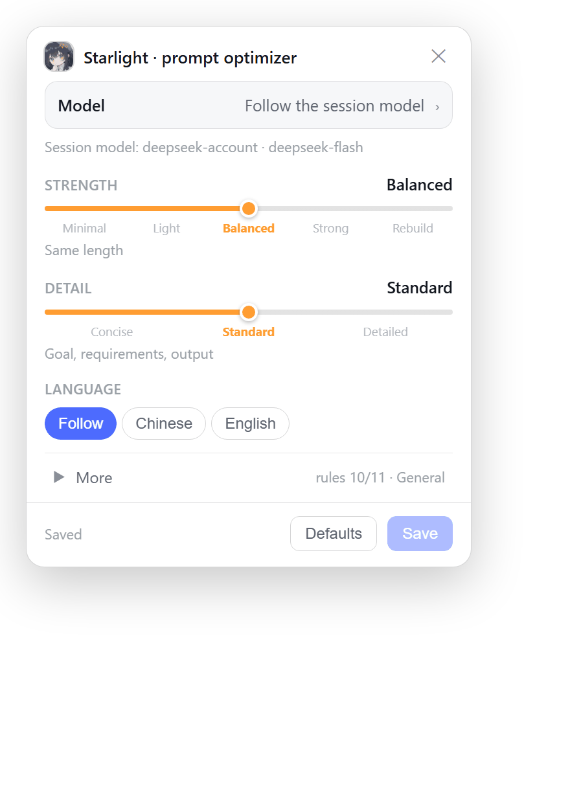
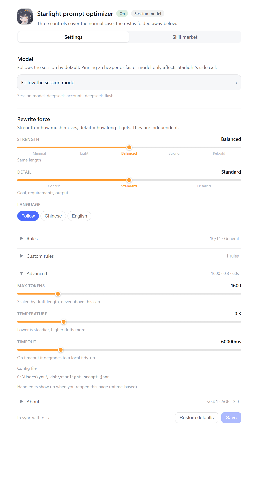

<p align="center">
  
</p>

<h1 align="center">Starlight · one-click prompt optimizer</h1>

<p align="center"><sub>DSH plugin · <strong>by Starlit Sky</strong></sub></p>

<p align="center">
  
  
  
  
</p>

A **circular four-pointed-star** button on the **left** of the DSH composer toolbar, wearing a hairline ring and soft glow so it lifts off the toolbar. One click turns your draft into a clearer, more complete, more executable prompt. Every rule, slider and model is **editable**, and there is a **dedicated settings page** (Settings → Starlight).

> A standalone plugin. No DSH source edits, no `index.html` injection, two official slot seats.

```
┌───────────────────────────────────────────────┐
│  Draft text…                                  │
│                                               │
│  (✦) [＋] [permissions]       [model] [send]  │
│   └ star button (left, ringed)                │
└───────────────────────────────────────────────┘
```

---

## Features

| | |
|---|---|
| ✦ One click | Read the draft → rewrite with the rule set → atomic write-back, caret returned to the editor |
| ✦ Editable rules | 11 built-in rules grouped as *structure / expression quality / fidelity guards*, each toggleable, with per-group counters and all-on / all-off |
| ✦ Custom rules | One per line; they outrank the built-in rules |
| 🎚 **Slider-first** | **Strength** (5 stops: minimal → light → balanced → strong → rebuild) and **Detail** (3 stops) are sliders with real stops, not three values padded into five |
| ✦ Scenario | General / engineering / writing / analysis, folded under “More” |
| ✦ Output language | Follow the draft / force Chinese / force English |
| 🎛 **Model switching** | Pick any model the host advertises (`provider · friendly name`), or keep the default "follow the session model". Affects only Starlight's side call, never your session model |
| ⚙ **Settings page** | **Settings → Starlight**: switch, shape, all 11 rules, custom rules, model, temperature / token cap / timeout — in one place |
| ↩ Undo | A toast after each run restores the previous draft in one click |
| ⌨ Shortcut | `Ctrl/⌘ + Shift + O` inside the composer |
| 🛟 Local fallback | No model, timeout or offline → mechanical tidy-up plus a stated reason, never a silent failure |
| 🖱 Right-click / long-press | Opens the compact rules popover (520 ms for touch); the settings page has everything else |

**It never** sends messages, creates turns, writes to the session log, or touches other plugins' settings.

### What it looks like

Popover (right-click / long-press) — four controls by default, everything else folded into “More”:



Settings page (Settings → Starlight) — model first, then the two sliders, the rest collapsed:



> Both are rendered from the **real components** by `node tools/make-shots.mjs` (jsdom + React + headless Edge), not hand-drawn mockups — they cannot drift from the shipped UI.

### Interface details

- The settings page leads with a star badge plus status pills (`On`/`Off`, current model) and a footer that always says `Unsaved changes` / `Saved` / `In sync with disk`; Save is disabled while clean.
- Rules lay out in two columns above 560 px, with an enabled/total counter per group. Loading shows a skeleton instead of a bare "loading…" line.
- The popover header shows an *Unsaved* pill; the undo toast carries a star and the model's friendly name.
- `prefers-reduced-motion` is respected: no spin, no pulse, no slide-in.

---

## Install

One npm package = one host half + one browser half.

### A. Install from a plugin market (recommended)

DSH ships no official market — **a "market" is a `format: 1` JSON index hosted at any https URL**. This repository carries one, so you can treat it as a market listing just this plugin:

1. Sidebar **Plugins** → **More** next to **Experimental plugins** → enable **Custom plugin markets**
2. Open **Discover** and add the index URL (**prefer the fastly host**):

   ```text
   https://fastly.jsdelivr.net/gh/Starlit-Sky-code/dsh-prompt-starlight@main/market/index.json
   ```

   jsDelivr's edge hosts differ a lot in reachability, especially on mainland China networks. Measured here:

   | Index URL | Measured |
   |---|---|
   | `https://fastly.jsdelivr.net/gh/Starlit-Sky-code/dsh-prompt-starlight@main/market/index.json` | 本次实测可达（1.4s） |
   | `https://gcore.jsdelivr.net/gh/Starlit-Sky-code/dsh-prompt-starlight@main/market/index.json` | 本次实测可达（0.9s） |
   | `https://testingcf.jsdelivr.net/gh/Starlit-Sky-code/dsh-prompt-starlight@main/market/index.json` | 本次实测可达（1.1s） |
   | `https://cdn.jsdelivr.net/gh/Starlit-Sky-code/dsh-prompt-starlight@main/market/index.json` | 官方 CDN 域名，本网络下 SSL 失败 |
   | `https://raw.githubusercontent.com/Starlit-Sky-code/dsh-prompt-starlight/main/market/index.json` | unreachable on this network |

   > Switching hosts is just a domain swap — the path is identical. Avoid `github.com/.../raw/...`: the host refuses redirects and that URL 302s to raw.githubusercontent.

3. Install from the list. DSH installs it into the current profile **pinned to the exact 40-character commit** in the index, so the result is reproducible.

> The index is validated with the official `@deepseek-ai/dsh-plugin-market-index` (`npm run market:validate`). The host caches a successful read for ten minutes, so a release is not visible instantly.

### B. Install a pinned commit directly

```powershell
dsh plugin add "git+https://github.com/Starlit-Sky-code/dsh-prompt-starlight.git#<40-char-commit>"
```

### C. Link this directory into the current profile (local development)

```powershell
$profile = "$env:DSH_HOME\profiles\desktop"
$pkg = Get-Content "$profile\package.json" -Raw | ConvertFrom-Json
$pkg.dependencies | Add-Member -NotePropertyName 'dsh-prompt-starlight' -NotePropertyValue 'link:D:\plugins\dsh-prompt-starlight' -Force
$pkg.dsh.profile.bundles += 'dsh-prompt-starlight'
$pkg | ConvertTo-Json -Depth 20 | Set-Content "$profile\package.json" -Encoding utf8

& "$env:DSH_HOME\resources\runtime\pnpm\bin\pnpm.cmd" install --dir $profile
```

Then **restart DSH** — the host half has to reload before the HTTP routes exist.

> The desktop profile is named `desktop`, and the CLI's `dsh plugin --profile` refuses it. Use the GUI or the manual link above; don't copy `--profile web` instructions from web-edition tutorials.

### Verify

```
http://127.0.0.1:19387/dsh-starlight/health
http://127.0.0.1:19387/plugins/dsh-prompt-starlight/client.js
```

JSON with `providers` = host half alive. JavaScript = the browser half made it into the boot graph. Both fine but no star? Hard-refresh (`Ctrl+Shift+R`).

### Where it is listed

| Channel | Mechanism | Status |
|---|---|---|
| **Index in this repository** | `market/index.json` (format 1, official validator passes) | ✅ live, URL above |
| **[awesome-dsh-plugin](https://github.com/awesome-dsh-plugin/awesome-dsh-plugin)** | one PR adding `data/plugins/<owner>__<repo>.yml` | 📝 entry ready in `market/awesome-entry.yml`, pending the "repo at least 1 day old" gate |
| **[dshbase.com](https://dshbase.com/plugins/directory/)** | per their docs, adding the `dsh-plugin` GitHub topic is what makes a repo discoverable | ⏳ topic still to add |
| **npm** | `npm publish`, then `dsh plugin add dsh-prompt-starlight` | ⏳ needs an npm login |
| Personal indexes (e.g. Silentforfar's market) | each author's private index | — not something to push an entry into |

### Publishing to npm (optional)

```powershell
npm login            # once; the publish target is already pinned to the official registry
npm publish
```

Then the shortest install form works:

```powershell
dsh plugin add dsh-prompt-starlight
```

> `package.json` pins `publishConfig.registry = https://registry.npmjs.org/` on purpose. If any global `.npmrc` points the registry at `npm.pkg.github.com`, **publishing fails with `ENEEDAUTH` even when you are logged in**, and the error only says "you need to log in" — a genuinely hard bug to trace. Pinning the target rules that failure mode out.

**Every release must re-pin the index**, otherwise users install the old commit:

```powershell
npm run market           # pin index.json to HEAD + the package.json version
npm run market:validate  # run the official validator
```

---

## Usage

| Action | Effect |
|---|---|
| Left click | Optimize the current draft (greyed out when empty) |
| Right click / long-press | Open the compact rules popover |
| **Settings → Starlight** | Open the dedicated settings page (everything, plus advanced fields) |
| `Ctrl/⌘ + Shift + O` | Optimize while the editor is focused |

Popover and settings-page edits both apply on **Save** and share one config document. **Restore defaults** resets every rule, slider and model override.

### What the settings page holds

Navigation id: `starlight`.

| Section | Contents |
|---|---|
| Switch | Master switch; off ⇒ the button only tidies formatting and never calls a model |
| Rewrite force | **Strength** (5-stop slider) + **Detail** (3-stop slider) + language (3 segments); the current stop's explanation sits under each slider |
| Rules | Folded by default: scenario chips, 11 grouped checkboxes with per-group counters, all-on / all-off, master switch |
| Custom rules | Folded: multi-line textarea, one rule per line |
| Model (first) | Dropdown to switch models (`Follow the session model` or any advertised model), with `⟳` to re-read the catalog |
| Advanced | Folded: `maxTokens` / `temperature` / `timeoutMs` as sliders, plus the config-file path |
| Config file | Absolute path of the config document; a clear reason plus **Retry** when the host is unreachable |

The footer shows `Unsaved changes` (amber) / `Saved` / `In sync with disk`, with **Restore defaults** and **Save** (disabled while clean).

### How model switching behaves

- `Follow the session model (recommended)` writes no `provider`/`model`: every click uses whatever model your session is on.
- Picking a concrete model pins it in the config — handy when you want a strong model for chat and a cheap fast one for rewriting.
- Host-side route order: **pinned config route → the session route reported by the browser → the host default model**. A failing candidate (`NO_ADAPTER`, missing credential, auth) falls through to the next.
- The catalog comes from `GET /dsh-starlight/models` (60 s cache, `?refresh=1` forces, 4 s timeout per provider, and a failing provider only becomes one entry in `errors`).

---

## Custom rules

Config file: `$DSH_HOME/starlight-prompt.json` (created on first save; safe to hand-edit, picked up immediately)

```json
{
  "version": 1,
  "enabled": true,
  "verbosity": "standard",
  "lens": "auto",
  "locale": "auto",
  "depth": "balanced",
  "disabledRules": ["assumptions"],
  "customRules": ["Always include an Acceptance section", "No 'please make sure' filler"],
  "maxTokens": 1600,
  "temperature": 0.3,
  "timeoutMs": 60000,
  "provider": "",
  "model": ""
}
```

Built-in rule ids:

```
goal requirements output structure concise precise
preserve verbatim noinvent assumptions acceptance
```

To replace the whole rule set, put all 11 ids in `disabledRules` and write your own rules into `customRules`.

---

## How it works

```
browser (lib/client.js)                      host (lib/index.js)
─────────────────────────                  ─────────────────────────
conversation.input.left slot                GET  /dsh-starlight/manifest
  └─ circular star button (ringed)          GET  /dsh-starlight/models
      ├─ read:  input.state snapshot         POST /dsh-starlight/optimize
      ├─ write: input.setDraft(text)         POST /dsh-starlight/config
      └─ undo:  previous draft               POST /dsh-starlight/reset
settings.section slot                        GET  /dsh-starlight/health
  └─ settings page (same form state)               │
                                            ctx.llm.stream({ provider, model,
                                              system: built from the rules,
                                              messages: JSON-framed draft })
```

Deliberate choices:

- **Rules live host-side, once.** The browser half is a classic script wrapped by DSH's `__ModuleLoader__`, so it cannot `import` local modules; the catalog always comes from `/manifest`. No two drifting copies.
- **The popover and the settings page share `useRulesConfig()`.** Loading, dirty-checking, saving and restoring have one implementation; the two surfaces are just different layouts over the same state machine, so they can never disagree.
- **The model catalog is its own request.** `listModels` may hit the network; folding it into `/manifest` would let a slow provider stall the rules panel. Separate route, 60 s cache, 4 s timeout per provider — a slow provider only shows up as one line of text.
- **The draft is JSON-framed** before it reaches the model, so ```` ``` ````, `<system>` or `---` inside it cannot forge a structural boundary.
- **The system prompt forbids executing the draft.** Otherwise "write me a binary search" gets answered with code instead of an improved prompt.
- **A failed model call is not a failed click**: it degrades to a mechanical tidy-up and says why.
- **The ring is `box-shadow` layers** (1 px outline + near shadow + far bloom), not `border`, so the button stays exactly 28×28 and never nudges the toolbar height; hover swaps the outline to the accent colour and blooms a 4 px halo.
- **Every registration is a reversible side effect**: routes via the `webServer.register()` disposer, styles tagged `data-plugin` for DSH to reclaim, listeners added in `ctx.effect()` and removed in its return value.

### Security boundary

All six routes require a loopback `Host` (`localhost` / `127.0.0.0/8` / `::1`), reject `Sec-Fetch-Site: cross-site`, and require `Origin` to match `Host` when present. Write routes (`/config`, `/reset`) additionally require the request to come from this machine. If the host exposes `connection.requestRejection`, it is consulted too and the stricter result wins.

Behind a reverse proxy or on a LAN, whitelist explicitly:

```
STARLIGHT_TRUSTED_HOSTS=192.168.1.9:19387,my-box.local
```

(The whitelist only relaxes read routes; writes always require the local machine, so possessing a web session never grants permission to rewrite your prompt rules.)

---

## Development

```powershell
node tools/test-package.mjs   # package shape & signatures: 67 checks
node tools/test-host.mjs      # host: 86 checks
node tools/test-client.mjs    # browser: 96 checks
```

`test-client.mjs` needs real React and jsdom, installed only under `tools/fixture`:

```powershell
cd tools\fixture
npm install
```

### See the interface without restarting

```powershell
npm run preview   # = node tools/make-preview.mjs && node tools/check-preview.mjs
```

Writes `tools/preview.html` — just open it. It is not a hand-drawn mock: the script mounts the **real components** (button, right-click popover, settings page) in jsdom with real React, then lifts the injected stylesheet and the rendered `outerHTML` into one page. So the preview cannot drift from what ships. It covers the toolbar position, five button states, a 3× zoom of the ring, the popover and the settings page, in light and dark themes.

`tools/check-preview.mjs` asserts the preview really contains those pieces, so it can't silently degrade into an empty shell.

### Regenerate the README screenshots

```powershell
node tools/make-shots.mjs   # writes docs/screenshots/{popover,settings}{,.zh}.png
```

Also renders the real components, then screenshots them with the local Edge/Chrome in headless mode — one set per locale.

`tools/asar-list.mjs` lists or unpacks DSH's `app.asar` for debugging.

---

## Compatibility

Verified against **DSH 0.2.0-rc.2** (`@deepseek-ai/dsh-client-ui-conversation` and `-settings-general` inside `app.asar`):

| Interface used | Source |
|---|---|
| `conversation.input.left` slot (`kind: list`, `scope: session`) | `registerComposerBar()` |
| `settings.section` slot (`kind: list`, `scope: root`; entries carry `id` / `order` / `label()`) | `SettingsRoot` in `dsh-client-ui-settings-general` |
| `ctx.slots.inject()` / `slots.register()` / `inject(sessionId)` | `dsh-client-ui-slots` |
| `conversation.input.for(actx)`, `.shell(sessionId)`, `.setDraft()`, `.state` snapshot | `SessionInputShell` / `InputHub` |
| `session.projections.faceOf('modelSelection')` | `SessionInputShell.submissionState()` |
| `ctx.llm.listProviders()` / `.listModels(provider)` | `@deepseek-ai/dsh-llm` |
| `ctx.llm.stream({ provider, model, messages, system, maxTokens, signal })` | `@deepseek-ai/dsh-llm` |
| `ctx.webServer.register({ kind, path, handler })` | `@deepseek-ai/dsh-host-webserver` |
| `agentDefaultModel.currentSelection()` | `@deepseek-ai/dsh-agent-default-model` |

Every possibly-absent service (`llm`, `agentDefaultModel`, `connection`, `sessions`, `conversation`) is read lazily through `ctx.get()` inside `try/catch`: a missing one only degrades a feature — it never parks the plugin in PENDING and never makes the composer disappear. A missing `settings.section` slot (older host) simply means no settings page; the button keeps working.

---

## Signature & license

**© 2026 Starlit Sky · AGPL-3.0** — see [NOTICE](NOTICE) and [LICENSE](LICENSE).

- Every source file opens with the same signature header, generated by
  `node tools/stamp-signature.mjs` and verified mechanically with `--check` —
  stripping it fails the test suite.
- `lib/client.js` ships to the browser verbatim, so the header and a runtime
  watermark appear directly in devtools.
- The host half prints the same line to the startup log (`STARLIGHT_QUIET=1` silences it).

[AGPL-3.0](LICENSE) is a strong copyleft licence with a network clause: running a
modified version as a network service obliges you to offer users the corresponding
source. Forks and redistributions stay under AGPL-3.0 and must keep the signature
headers and LICENSE.

Relicensing under a permissive licence (vendoring into a closed product or hosted
service) requires a commercial licence from the copyright holder — open an
[issue](https://github.com/Starlit-Sky-code/dsh-prompt-starlight/issues) to discuss.
Relicensing is the copyright holder's decision; don't route around it.
