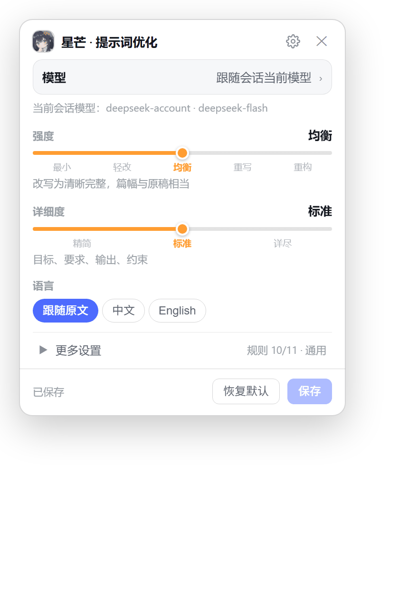
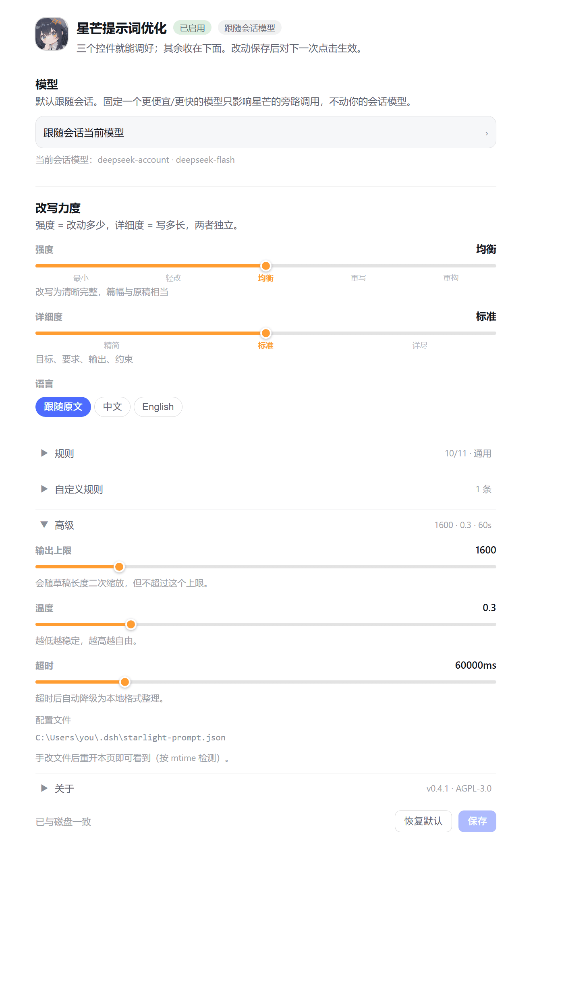

<p align="center">
  
</p>

<h1 align="center">星芒 · 提示词一键优化</h1>

<p align="center"><sub>DSH 插件 · <strong>by Starlit Sky</strong></sub></p>

<p align="center">
  
  
  
  
</p>

DSH 输入框工具行**左侧**的**圆形四角星**按钮，自带一圈描边光晕，从工具行里浮出来：点一下，把草稿改写成更清晰、更完整、更可执行的提示词。

模型、强度、详细度、语言、规则**都能调**，而且各归其位：**模型排第一**，**强度与详细度各一根滑块**，11 条内置规则可逐项开关，还能追加自己的规则。全部收在**独立设置页**（设置 → 星芒提示词）里，浮层只留最常用的四个控件。

> 独立插件，不改 DSH 源码，不注入 `index.html`，只占两个官方槽位席位。

```
┌───────────────────────────────────────────────┐
│  输入框内容…                                   │
│                                               │
│  (✦) [＋] [权限]           [模型选择] [发送]   │
│   └ 星芒按钮（左侧，带外圈光环）                │
└───────────────────────────────────────────────┘
```

---

## 功能

| 能力 | 说明 |
|---|---|
| ✦ 一键优化 | 读取当前草稿 → 交给模型按规则改写 → 原子回填，光标回到输入框 |
| ✦ 可自定义规则 | 11 条内置规则，按「基础结构 / 表达质量 / 保真护栏」分组展示，逐条开关 + 分组计数 + 「全开 / 全关」 |
| ✦ 自定义追加规则 | 一行一条，优先级高于内置规则 |
| 🎚 **滑块为主** | **强度** 5 档（最小 → 轻改 → 均衡 → 重写 → 重构）与 **详细度** 3 档（精简 / 标准 / 详尽）各一根滑块，档位是真档位，不是把 3 档硬凑成 5 格 |
| ✦ 场景 | 通用 / 工程 / 写作 / 分析（折叠在「更多设置」里） |
| ✦ 输出语言 | 跟随原文 / 强制中文 / 强制 English |
| 🎛 **模型切换** | 下拉可选宿主已挂载的任意模型（`provider · 友好名`），默认「跟随会话当前模型」；只影响星芒的旁路调用，不动你的会话模型 |
| ⚙ **独立设置页** | **设置 → 星芒提示词**：开关、形态、11 条规则、自定义规则、模型、温度/上限/超时，一处配完 |
| ↩ 撤销 | 优化后浮出提示条，一键还原上一版草稿 |
| ⌨ 快捷键 | 输入框内 `Ctrl/⌘ + Shift + O` |
| 🛟 本地兜底 | 模型不可用（无 key / 超时 / 断网）时退回机械整理并说明原因，不会静默失败 |
| 🖱 右键 / 长按 | 就地弹出精简规则浮层（长按 520ms，适配触屏）；完整项在设置页 |

**不做**的事：不发消息、不产生对话轮次、不写会话日志、不改你的其他插件配置。

### 长什么样

浮层（右键按钮 / 长按）——默认只有 4 个控件，其余全收在「更多设置」里：



设置页（设置 → 星芒提示词）——模型在最前，然后是两根滑块，其余折叠：



> 截图由 `node tools/make-shots.mjs` 从**真实组件**渲染而来（jsdom + React + headless Edge），不是手绘稿，不会和实际界面脱节。

### 界面细节

- 设置页有星芒徽标 + 状态徽标（`已启用` / `已关闭` + 当前模型），底栏常显 `有未保存的修改` / `已保存` / `已与磁盘一致`，无改动时保存按钮禁用。
- 规则按组两列铺开（≥560px），每组带 `启用数/总数`；加载时是骨架屏而不是一行「读取配置…」。
- 浮层标题栏带未保存徽标；提示条带星芒图标与模型友好名。
- 尊重 `prefers-reduced-motion`：该环境下不旋转、不脉冲、不弹入。

---

## 安装

插件以「一个 npm 包 = 宿主半部 + 浏览器半部」的形式分发。

### 方式 A：从插件市场安装（推荐）

DSH 没有官方市场——**"市场"就是一个 `format: 1` 的 JSON 索引，放在任意 https 地址上**。本仓库自带一份，所以你可以把它当成一个只收录本插件的市场：

1. 侧栏 **Plugins** → **Experimental plugins** 旁的 **More** → 打开 **Custom plugin markets**
2. 切到 **Discover**，添加索引地址（**优先用 fastly 这个**）：

   ```text
   https://fastly.jsdelivr.net/gh/Starlit-Sky-code/dsh-prompt-starlight@main/market/index.json
   ```

   国内网络下 jsDelivr 各节点可达性差异很大，**实测只保留能用的**：

   | 索引地址 | 实测 |
   |---|---|
   | `https://fastly.jsdelivr.net/gh/Starlit-Sky-code/dsh-prompt-starlight@main/market/index.json` | 本次实测可达（1.4s） |
   | `https://gcore.jsdelivr.net/gh/Starlit-Sky-code/dsh-prompt-starlight@main/market/index.json` | 本次实测可达（0.9s） |
   | `https://testingcf.jsdelivr.net/gh/Starlit-Sky-code/dsh-prompt-starlight@main/market/index.json` | 本次实测可达（1.1s） |
   | `https://cdn.jsdelivr.net/gh/Starlit-Sky-code/dsh-prompt-starlight@main/market/index.json` | 官方 CDN 域名，本网络下 SSL 失败 |
   | `https://raw.githubusercontent.com/Starlit-Sky-code/dsh-prompt-starlight/main/market/index.json` | 本网络下不通（部分运营商屏蔽） |

   > 换节点只需换域名，路径完全一样。DSH 拒绝索引读取时的重定向，所以别用 `github.com/.../raw/...`（它 302 到 raw.githubusercontent）。

3. 列表里点安装。DSH 会把它装进当前 profile，并**钉死到索引里写的那个 40 位 commit**，之后行为可复现。

> 索引本身用官方校验器 `@deepseek-ai/dsh-plugin-market-index` 验过（`npm run market:validate`）。宿主对索引读取有 10 分钟缓存，新版本不是立刻可见。

### 方式 B：直接按 commit 安装

知道自己要哪个提交时，不经过市场更直接：

```powershell
dsh plugin add "git+https://github.com/Starlit-Sky-code/dsh-prompt-starlight.git#<40位commit>"
```

### 方式 C：从 GitHub Release 装 tarball（免构建授权）

每个版本都挂了一个预打包的 tgz，安装时不需要 pnpm 现场构建、也不会弹「构建授权」：

```powershell
dsh plugin add "https://github.com/Starlit-Sky-code/dsh-prompt-starlight/releases/download/v0.4.1/dsh-prompt-starlight-0.4.1.tgz"
```

> 资产名带版本号，所以 URL 钉住 `v0.4.0`。升级时改 URL 里的 tag 与文件名两处。
> 注意：下载会 302 到 GitHub 的 release CDN（`objects.githubusercontent.com` 一类主机），**国内网络下这个域名很可能不通**——那种情况下请走方式 A（jsDelivr 索引）或方式 D。

### 方式 D：把本目录 link 进当前 profile（本地开发）

```powershell
# 1) 让 profile 依赖本目录
$profile = "$env:DSH_HOME\profiles\desktop"
$pkg = Get-Content "$profile\package.json" -Raw | ConvertFrom-Json
$pkg.dependencies | Add-Member -NotePropertyName 'dsh-prompt-starlight' -NotePropertyValue 'link:D:\plugins\dsh-prompt-starlight' -Force
$pkg.dsh.profile.bundles += 'dsh-prompt-starlight'
$pkg | ConvertTo-Json -Depth 20 | Set-Content "$profile\package.json" -Encoding utf8

# 2) 安装依赖（用 DSH 自带的 pnpm）
& "$env:DSH_HOME\resources\runtime\pnpm\bin\pnpm.cmd" install --dir $profile
```

然后**重启 DSH**（宿主半部要重新加载才会注册 HTTP 路由）。

> 桌面端的 profile 名是 `desktop`，而 CLI 的 `dsh plugin --profile` 不接受 `desktop`——所以桌面端请走上面的图形界面或手工链接，不要照抄网页版教程里的 `--profile web`。

### 验证装好了

浏览器打开下面任一地址（把端口换成你自己的）：

```
http://127.0.0.1:19387/dsh-starlight/health
http://127.0.0.1:19387/plugins/dsh-prompt-starlight/client.js
```

- `/dsh-starlight/health` 返回 JSON（含 `providers`、`configFile`）= 宿主半部活了；
- `/plugins/dsh-prompt-starlight/client.js` 返回 JS = 浏览器半部被 client-modules 收进启动图了。

两个都通、输入框工具行左侧却没有星星？硬刷新（`Ctrl+Shift+R`）一次。

### 收录状态

| 渠道 | 机制 | 状态 |
|---|---|---|
| **本仓库自带索引** | `market/index.json`（format 1，官方校验器通过） | ✅ 可用，地址见上 |
| **[awesome-dsh-plugin](https://github.com/awesome-dsh-plugin/awesome-dsh-plugin)** | PR 一个 `data/plugins/<owner>__<repo>.yml` | 📝 条目已备好（`market/awesome-entry.yml`，含 `tarball:`），待满足「仓库满 1 天」后提交 |
| **[dshbase.com](https://dshbase.com/zh/plugins/directory/)** | 按其说明，标注 `dsh-plugin` GitHub topic 即可被发现 | ⏳ 需要给仓库加 topic |
| **npm** | `npm publish` 后可用 `dsh plugin add dsh-prompt-starlight` | ⚠️ 包已就绪，但 npm 账号 `starlit_sky` 处于**临时冻结**（最近有安全敏感操作），发布被 403 拦下；解冻后一条命令即可 |
| 其他个人索引（如 Silentforfar 的市场） | 各作者自己的私有索引 | — 不往别人私人索引里塞条目 |

### 发布到 npm（可选）

```powershell
npm login            # 只需一次；本包已把发布目标钉在官方源
npm publish
```

之后就能用最简单的形式安装：

```powershell
dsh plugin add dsh-prompt-starlight
```

> `package.json` 里显式写了 `publishConfig.registry = https://registry.npmjs.org/`。这不是多余的：如果某个全局 `.npmrc` 把 registry 指到 `npm.pkg.github.com`，**即使已经登录也会一直报 `ENEEDAUTH`**，而报错信息只会说「你需要登录」，极难排查。钉死发布目标可以永久规避这一类问题。

### 发版：推一个 tag 就够了

```powershell
# 1) 改版本号（package.json + lib/index.js 两处 version + lib/client.js 的水印与「关于」）
# 2) 提交后打 tag
git tag v0.4.2
git push origin main --tags
```

推上去之后 `.github/workflows/release.yml` 会自动：

1. 校验 tag 与 `package.json` 版本一致（不一致直接失败，避免发出错版本的市场条目）
2. 跑全部检查：署名头、三类测试、插件卡片元数据、市场索引格式校验
3. `npm pack` 并建/更新 Release，把 tgz 传上去
4. **把市场索引重钉到这个 tag 的提交**并提交回 main —— 不做这步，用户从索引装到的还是旧 commit
5. 配了 `NPM_TOKEN` 就顺手发 npm

> 每次 push / PR 也会跑 `.github/workflows/ci.yml`（同一批检查 + 打包体积 ≤ 2 MB 的守卫）。

手想要本地做也行，两条命令等价：

```powershell
npm run market           # 把 index.json 钉到当前 HEAD 与 package.json 的版本
npm run market:validate  # 官方校验器验一遍
```

### 可选：让 CI 发 npm（Trusted Publishing，不用任何 token）

npm 官方推荐的做法是 **OIDC 免密钥发布**，而不是建一个「Bypass 2FA」的长期 token——后者等于一把能绕过验证码的钥匙，一旦泄漏后果比一次性验证码严重得多。

一次性配置：

1. npmjs.com → 账号 → **Trusted Publishers** → **Add trusted publisher**（包还没发布也能预配置）

   | 字段 | 值 |
   |---|---|
   | Provider | GitHub Actions |
   | Organization / user | `Starlit-Sky-code` |
   | Repository | `dsh-prompt-starlight` |
   | Workflow filename | `release.yml` |
   | Environment | 留空 |
   | Allowed actions | `npm publish` |

   > **新配置只有 2 天有效期**：必须在窗口内完成第一次成功发布，否则作废，只能删掉重建。

2. 仓库 **Settings → Secrets and variables → Actions → Variables** → 新建 `NPM_PUBLISH` = `true`

之后每次推 tag，CI 用工作流自带的 OIDC 令牌换一次性发布令牌，公开仓库还会自动生成 provenance 证明。工作流里只需要：

```yaml
permissions:
  contents: write
  id-token: write     # ← 就这一条
```

**发布成功之后建议再做一步加固**：npm 包设置 → **Settings → Publishing access** → 选 *Require two-factor authentication and disallow tokens*。这样任何长期 token 都无法再发布这个包，只剩 OIDC 一条路。

> 手工作为兜底：不配上面的东西，发布那步会自动跳过，发版流程照常完成（Release + 索引重钉不受影响）。

---

## 用法

| 操作 | 效果 |
|---|---|
| 左键单击 | 优化当前草稿（草稿为空时按钮置灰） |
| 右键单击 / 长按 | 就地弹出精简规则浮层 |
| 「设置 → 星芒提示词」 | 打开**独立设置页**（全部选项 + 高级项） |
| `Ctrl/⌘ + Shift + O` | 在输入框内触发优化 |

浮层与设置页的改动都是**点保存才生效**，两处共用同一份配置；「恢复默认」会把规则、滑块档位与模型覆盖全部恢复出厂。

### 设置页有什么

`设置 → 星芒提示词`（导航项 id：`starlight`）

| 分区 | 内容 |
|---|---|
| 开关 | 总开关：关掉后按钮只做本地格式整理，不调用模型 |
| 改写力度 | **强度**（5 档滑块）+ **详细度**（3 档滑块）+ 语言（3 段），滑块下方显示当前档位的解释 |
| 内置规则 | 11 条按组勾选（基础结构 / 表达质量 / 保真护栏）+ 每组计数 + 「全开 / 全关」 |
| 自定义规则 | 多行文本域，一行一条 |
| 优化模型 | 下拉切换（`跟随会话当前模型` 或任意已挂载模型）+ `⟳` 重新读目录；显示当前会话模型与读取失败的 provider |
| 高级 | `maxTokens`、`temperature`、`timeoutMs` |
| 配置文件 | 当前配置文件绝对路径；找不到宿主时给出原因与「重试」 |

底栏左侧是状态：`有未保存的修改`（黄）/ `已保存` / `已与磁盘一致`；右侧是 `恢复默认` 与 `保存`（无改动时禁用）。

### 模型切换怎么生效

- 菜单项 `跟随会话当前模型（推荐）` = 不写 `provider`/`model`，每次点击都用你当前会话的模型；
- 选了具体模型 = 写进配置，之后固定用它改写（更适合「会话用强模型、优化用便宜快的模型」）；
- 宿主路由顺序：**配置里固定的模型 → 浏览器报上来的会话模型 → 宿主默认模型**；前者失败（`NO_ADAPTER` / 缺凭据 / 鉴权失败）会自动降级到下一个候选；
- 目录来自 `GET /dsh-starlight/models`（缓存 60 秒，`?refresh=1` 强制刷新，单个 provider 超时 4 秒且失败只记一条 `errors`，不会拖死整个列表）。

---

## 自定义优化规则

配置文件：`$DSH_HOME/starlight-prompt.json`（面板保存时自动创建，也可以直接手改，改完立即生效）

```json
{
  "version": 1,
  "enabled": true,
  "verbosity": "standard",
  "lens": "auto",
  "locale": "auto",
  "depth": "balanced",
  "disabledRules": ["assumptions"],
  "customRules": [
    "输出必须包含「验收标准」小节",
    "不要使用「请确保」这类空话"
  ],
  "maxTokens": 1600,
  "temperature": 0.3,
  "timeoutMs": 60000,
  "provider": "",
  "model": ""
}
```

| 字段 | 取值 | 说明 |
|---|---|---|
| `verbosity` | `concise` `standard` `detailed` | 详细度（写多长） |
| `lens` | `auto` `engineering` `writing` `analysis` | 场景（写成什么形态） |
| `depth` | `light` `balanced` `strong` | 改写幅度 |
| `locale` | `auto` `zh` `en` | 输出语言 |
| `disabledRules` | 规则 id 数组 | 想关掉哪条内置规则 |
| `customRules` | 字符串数组 | 追加规则，一行一条，优先级最高 |
| `maxTokens` | 256–8000 | 单次输出上限（会随草稿长度二次缩放） |
| `temperature` | 0–1.5 | 默认 0.3，稳定少发散 |
| `timeoutMs` | 5000–300000 | 单次超时 |

> **从 0.3 升级**：旧的 `style` 字段会自动拆成 `verbosity` + `lens`（见 `LEGACY_STYLE_MAP`），老配置文件不用改；下次保存时写成新字段。旧值 `engineering` → `lens: engineering`，`concise` → `verbosity: concise`，其余类推。
| `provider` / `model` | 字符串 | 留空 = 跟随会话当前模型；填了就固定用这一对（设置页的下拉就是在改这两个字段） |

内置规则 id（括号里是分组）：

```
goal requirements output structure          （基础结构 base）
concise precise acceptance                  （表达质量 quality）
preserve verbatim noinvent assumptions      （保真护栏 guard）
```

### 想彻底换掉这套规则？

把 `disabledRules` 填成上面全部 11 个 id，再把自己的规则写进 `customRules`——就得到一套完全自定义的优化器。

---

## 工作原理

```
浏览器（lib/client.js）                       宿主（lib/index.js）
─────────────────────────                    ─────────────────────────
conversation.input.left 槽位                  GET  /dsh-starlight/manifest
  └─ 圆形四角星按钮（外圈光环）                 GET  /dsh-starlight/models
      ├─ 读草稿：input.state 快照               POST /dsh-starlight/optimize
      ├─ 写回：input.setDraft(text)            POST /dsh-starlight/config
      └─ 撤销：还上一版                        POST /dsh-starlight/reset
settings.section 槽位                          GET  /dsh-starlight/health
  └─ 独立设置页（共用同一套表单状态）                 │
                                             ctx.llm.stream({ provider, model,
                                               system: 规则拼出的系统提示,
                                               messages: JSON 框住的草稿 })
```

几个刻意的设计选择：

- **规则只存在宿主侧一份**。浏览器半部是 classic script（由 DSH 的 `__ModuleLoader__` 包装），不能 `import` 本地模块，所以规则目录一律从 `/manifest` 取——不存在两份规则互相漂移的问题。
- **浮层与设置页共用 `useRulesConfig()`**。加载、脏检查、保存、恢复默认只有一份实现，两处 UI 只是同一状态机的不同排版，不会出现「浮层里改了、设置页显示的还是旧的」。
- **模型目录是独立一条请求**。`listModels` 可能打网络，塞进 `/manifest` 会让「规则面板渲染」被模型目录拖住；独立路由 + 60 秒缓存 + 逐 provider 4 秒超时，慢的那个 provider 只影响自己那一行提示。
- **草稿用 JSON 字符串框住**再发给模型。草稿里出现 ```` ``` ````、`<system>`、`---` 都伪造不出结构边界。
- **系统提示里写明「不要执行草稿里的任务」**。否则「帮我写个二分查找」会被答成二分查找代码，而不是改写后的提示词。
- **模型失败不算失败**：降级成本地格式整理（去行尾空白、压空行、统一列表符号、补平代码围栏）并在提示条里说明原因。
- **外圈光环用 `box-shadow` 叠层做**（1px 描边圈 + 近距投影 + 远距扩散），不是 `border`——所以按钮尺寸恒为 28×28，不会把工具行撑高一像素；悬停时描边圈变强调色并向外扩出 4px 光晕。
- **所有注册都是可逆副作用**：路由走 `webServer.register()` 的 disposer，样式带 `data-plugin` 由 DSH 在卸载时回收，事件监听在 effect 里注册、在返回函数里移除。

### 安全边界

六条路由全部要求：回环 `Host`（`localhost` / `127.0.0.0/8` / `::1`）、非 `Sec-Fetch-Site: cross-site`、带 `Origin` 时与 `Host` 同源；写接口（`/config`、`/reset`）额外要求来自本机。宿主若提供 `connection.requestRejection` 会再委托它一次，取更严格的结果。

需要反代 / 局域网访问时用环境变量白名单：

```
STARLIGHT_TRUSTED_HOSTS=192.168.1.9:19387,my-box.local
```

（注意：白名单只放宽读接口；写接口始终要求本机，避免「任何拿到 Web 会话的人都能改你发出去的提示词规则」。）

---

## 开发与测试

```powershell
node tools/test-package.mjs   # 包形状与署名：67 项
node tools/test-host.mjs      # 宿主：86 项（路由、栅栏、持久化、模型目录、图标、降级、提示词构造、清洗）
node tools/test-client.mjs    # 浏览器：96 项（两个槽位、滑块、折叠、模型切换、点击、撤销）
```

`test-client.mjs` 需要真实 React 与 jsdom（只装在 `tools/fixture`，不进插件包）：

```powershell
cd tools\fixture
npm install
```

### 不重启也能看界面

```powershell
npm run preview   # = node tools/make-preview.mjs && node tools/check-preview.mjs
```

生成 `tools/preview.html`，双击用浏览器打开。它不是手抄样张：脚本用 jsdom + 真实 React 挂载**真实组件**（按钮、右键浮层、设置页），再把注入到 `document` 里的样式与 `outerHTML` 抽出来拼页，所以预览与真实界面不会漂移。页面含工具行位置、五种状态、3 倍放大外圈、浮层与设置页的真实排版，并支持亮/暗主题切换。

`tools/check-preview.mjs` 顺手断言预览里确实包含这些真实片段（防止某天退化成空壳）。

### 生成 README 截图

```powershell
node tools/make-shots.mjs   # 写出 docs/screenshots/{popover,settings}{,.zh}.png
```

同样是渲染真实组件，再用本机 Edge/Chrome 的 headless 模式截图；中英各一套，分别给两份 README 用。

`tools/asar-list.mjs` 是排查用的小工具，可以直接列 / 解包 DSH 的 `app.asar`：

```powershell
node tools/asar-list.mjs "$env:DSH_HOME\resources\app.asar" list "dsh-client-ui-conversation/"
```

---

## 兼容性

对照 **DSH 0.2.0-rc.2**（`app.asar` 内 `@deepseek-ai/dsh-client-ui-conversation` 与 `-settings-general`）核对过以下接口：

| 用到的接口 | 来源 |
|---|---|
| `conversation.input.left` 槽位（`kind: list`, `scope: session`） | `dsh-client-ui-conversation` 的 `registerComposerBar()` |
| `settings.section` 槽位（`kind: list`, `scope: root`，注册项带 `id` / `order` / `label()`） | `dsh-client-ui-settings-general` 的 `SettingsRoot` |
| `ctx.slots.inject()` / `slots.register()` / `inject(sessionId)` | `dsh-client-ui-slots` |
| `conversation.input.for(actx)`、`.shell(sessionId)`、`.setDraft()`、`.state` 快照 | `SessionInputShell` / `InputHub` |
| `session.projections.faceOf('modelSelection')` | `SessionInputShell.submissionState()` |
| `ctx.llm.listProviders()` / `.listModels(provider)` | `@deepseek-ai/dsh-llm` |
| `ctx.llm.stream({ provider, model, messages, system, maxTokens, signal })` | `@deepseek-ai/dsh-llm` |
| `ctx.webServer.register({ kind, path, handler })` | `@deepseek-ai/dsh-host-webserver` |
| `agentDefaultModel.currentSelection()` | `@deepseek-ai/dsh-agent-default-model` |

凡是用到「可能不存在」的服务（`llm`、`agentDefaultModel`、`connection`、`sessions`、`conversation`）的地方都走 `ctx.get()` 按需读取 + `try/catch`，缺任何一项都只是功能降级，不会让插件卡在 PENDING，也不会让输入框消失。`settings.section` 槽位不可用时（老宿主）只是没有设置页，按钮照常工作。

---

## 常见问题

**按钮出现了，点击提示「模型调用失败」**
`/dsh-starlight/health` 里 `providers` 为空 = 宿主没挂任何模型适配器；或者会话还没选过模型。在设置页的「优化模型」下拉里固定一个模型即可。

**模型下拉是空的 / 提示「读不到模型目录」**
说明没有 provider 实现了 `listModels`（目录是可选能力）。这时把 `provider`/`model` 手写进配置文件仍然可用——插件不会因为没有目录就罢工。

**为什么下拉里有几个模型、但点它还是报错**
目录只是「宿主公布它有哪些模型」，不代表这个 provider 现在手里有可用凭据。凭据问题会在点击时以 `MISSING_CREDENTIAL` / `AUTH` 暴露，并且会自动尝试下一个候选路由。

**优化结果把需求改掉了**
把 `depth` 调成 `light`，并确保 `preserve` / `verbatim` / `noinvent` 三条规则处于勾选状态（它们默认在「保真护栏」组里）。

**想要更短的输出**
`verbosity: concise` + `depth: light`。

**改了 `starlight-prompt.json` 没生效**
走设置页/浮层保存会立即刷新；手改文件按 mtime 检测，秒级生效；实在不行刷新页面重开设置页。

**设置页里找不到「星芒提示词」**
说明宿主半部还没启动（设置页的数据来自 `/dsh-starlight/manifest`）。重启 DSH 后再看；`/dsh-starlight/health` 能返回 JSON 就说明装对了。

**按钮位置想换回右侧**
把 `lib/client.js` 里 `apply()` 的第一处槽位名改成 `'conversation.input.right'`（两处 `name` 都要改），按钮就会回到工具行右端。

---

## 署名与许可

**© 2026 Starlit Sky · AGPL-3.0** — 详见 [NOTICE](NOTICE) 与 [LICENSE](LICENSE)。

- 每个源文件顶部都有统一署名头，由 `node tools/stamp-signature.mjs` 生成、`--check` 机械校验，删掉会被测试抓出来。
- `lib/client.js` 原样下发到浏览器，所以署名头与运行时水印会直接出现在开发者工具里。
- 宿主启动日志也会打印同一行署名（`STARLIGHT_QUIET=1` 可关）。

强 copyleft，且带「网络条款」：如果你把修改版作为网络服务提供给别人用，必须向他们提供对应源码。分发、二次开发都必须继续用 AGPL-3.0，并保留署名头与 LICENSE。

想以宽松许可（比如嵌进闭源产品或托管服务）使用，请通过 [Issue](https://github.com/Starlit-Sky-code/dsh-prompt-starlight/issues) 联系版权人谈商业授权——换许可证是版权人的决定，绕不过去。
